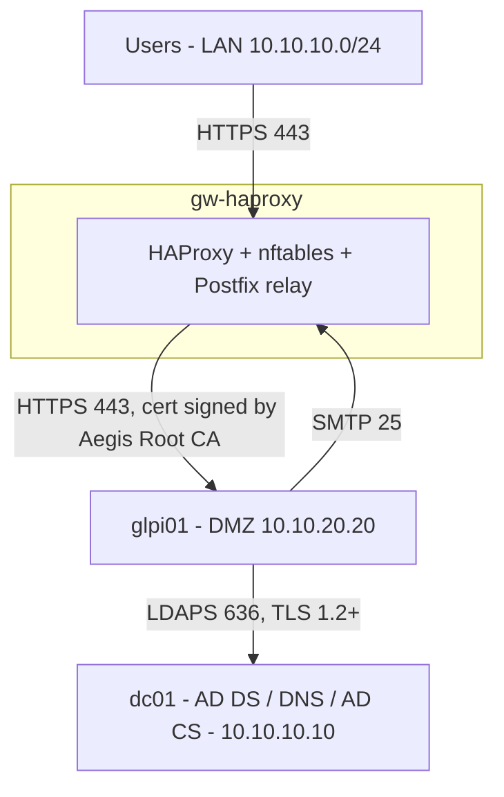

# Architecture and IP plan

## Identity

| Item | Value |
|---|---|
| Company (fictional) | Aegis Corp |
| AD domain (DNS) | `ad.aegis-corp.lab` |
| NetBIOS name | `AEGIS` |
| Portal name | Portail Support DSI Aegis |
| Portal FQDN | `support.ad.aegis-corp.lab` |
| Root CA | `Aegis Root CA` |

## Networks (VMware Workstation)

| VMnet | Role | Subnet | Type | DHCP |
|---|---|---|---|---|
| VMnet3 | LAN | 10.10.10.0/24 | Host-only | Off |
| VMnet4 | DMZ | 10.10.20.0/24 | Host-only | Off |
| VMnet8 | Internet (updates only) | auto | NAT | n/a |

VMnet0 (bridged) is not used, to keep the lab isolated from the physical network.

## Hosts

| Host | OS | RAM | vCPU | Disk | NICs | IPs |
|---|---|---|---|---|---|---|
| `dc01` | Windows Server 2022 | 2 GB | 2 | 40 GB thin | VMnet3 | 10.10.10.10 |
| `gw-haproxy` | Ubuntu Server 24.04 | 768 MB | 1 | 10 GB thin | VMnet8, VMnet3, VMnet4 | DHCP / 10.10.10.5 / 10.10.20.5 |
| `glpi01` | Ubuntu Server 24.04 | 1.5 GB | 2 | 20 GB thin | VMnet4 | 10.10.20.20 |

`gw-haproxy` is the only VM with a NAT interface (`dc01` and `glpi01` must never have one, see the lessons learned in the Phase 1 guide). It acts as router, firewall and reverse proxy. During installation phases it also provides temporary internet access (masquerade) to the other VMs. That rule is removed in Phase 9.

## Allowed flows (default deny)

| # | Source | Destination | Port | Purpose |
|---|---|---|---|---|
| 1 | Users (LAN) | gw-haproxy | 443/tcp | Portal access |
| 2 | gw-haproxy | glpi01 | 443/tcp | Re-encrypted backend traffic |
| 3 | glpi01 | dc01 | 636/tcp | LDAPS authentication |
| 4 | glpi01 | dc01 | 53/tcp+udp | DNS |
| 5 | glpi01 | dc01 | 123/udp | Time sync |
| 6 | glpi01 | gw-haproxy | 25/tcp | SMTP relay |
| 7 | LAN | gw-haproxy | 22/tcp | Administration (SSH) |

Users never talk to GLPI directly, and GLPI is never exposed to the LAN.

## Diagram

